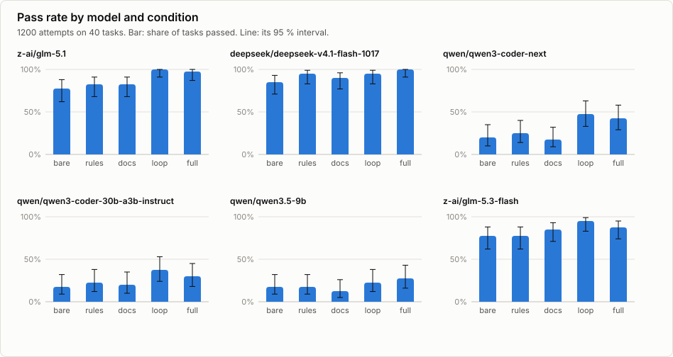

# Findings

Six coding models, 40 ArkTS tasks, five conditions: 1200 attempts, each judged without a model. Run on 16 and
17 November 2026 through OpenRouter at temperature 0, for USD 8.16. Every number here is copied from
[`results/eval-full.md`](../results/eval-full.md), which `npm run lab -- report` writes from
[`results/eval-full.jsonl`](../results/eval-full.jsonl). The conditions and the judge are described in the
[README](../README.md).

Tasks passed, of 40:

| Model | bare | rules | docs | loop | full |
| --- | --- | --- | --- | --- | --- |
| z-ai/glm-5.1 | 31 | 33 | 33 | 40 | 39 |
| deepseek/deepseek-v4.1-flash-1017 | 34 | 38 | 36 | 38 | 40 |
| z-ai/glm-5.3-flash | 31 | 31 | 34 | 38 | 35 |
| qwen/qwen3-coder-next | 8 | 10 | 7 | 19 | 17 |
| qwen/qwen3-coder-30b-a3b-instruct | 7 | 9 | 8 | 15 | 12 |
| qwen/qwen3.5-9b | 7 | 7 | 5 | 9 | 11 |
| All six, of 240 | 118 (49 %) | 128 (53 %) | 123 (51 %) | 159 (66 %) | 154 (64 %) |

## What the numbers say

**1. The checker in the loop is what closes the gap.** Showing a model the checker's errors on its own answer,
up to three times, took the six models together from 118 to 159 tasks passed. GLM-5.1 went from 31 to all 40
and GLM-5.3 Flash from 31 to 38; the two Qwen coder models about doubled, from 8 to 19 and from 7 to 15. Task
by task, the loop fixed 46 tasks across the six models and broke 5. This is what an IDE already computes:
diagnostics with a line and a rule name.

**2. A page of rules or the API reference, given once, changes little.** `rules` (128) and `docs` (123) are
within the noise of `bare` (118). Each fixes some tasks and breaks others: for GLM-5.1, `docs` fixed 7 tasks
and broke 5. Context that the model must apply by itself helped less than feedback on what it wrote.

**3. Everything together is not better than the loop alone.** `full` passed 154 tasks and `loop` 159, and it
cost more: for GLM-5.1, USD 1.73 against USD 0.57 for the same 40 tasks.

**4. The gap is the platform more than the language.** On a first answer the most common errors are names that
do not exist (`TS2304` in 143 attempts, `TS2339` in 137): invented components, attributes and imports. The
ArkTS rules come after (`arkts-no-any-unknown`, 127). The harder ArkUI and logic tasks separate the models
most: with no help, the three strong models passed 14 of 30 of them, and the three Qwen models none.

**5. A checker gets code to compile. It does not make it right.** From `bare` to `loop`, failures at the
checker fell from 102 to 55, and failures at the hidden tests rose from 9 to 17: more answers got far enough to
be wrong. Of the 45 attempts of the two Qwen coder models that failed there, 25 are one mistake the checker
cannot see: the class or function the task asks for is declared without `export`.

**6. Small models carry habits from other UI frameworks.** 21 failed attempts of the Qwen models end with
ordinary statements where only UI may stand. In 12 of them the click handler is written as the body of the
button (`Button('Add') { this.count++ }`), and 12 of the 21 are final answers after three repairs. The
smallest model passed no ArkUI task under any condition except two under `full`.

**7. Some answers never end.** With a limit of 48 000 output tokens (40 960 for one model), 42 attempts were
still cut off: 23 of Qwen3.5 9B, 12 of GLM-5.3 Flash and 7 of DeepSeek V4.1 Flash. They are reasoning that
does not converge or one line repeated until the limit. An agent that calls these models needs a budget and a
stop of its own.

## What running it taught

The failures were read one by one before any number was written down, and that found seven defects in the
harness and the judge. Most of them counted a right answer as wrong: an output limit that cut answers off, and
a higher one that still did; a UI check that was too strict; a time limit that recorded a slow call as an empty
answer; a memory leak; a judge that rejected a top-level `@Builder` function; and a checker that ran out of
stack on two runaway answers. 142 of the 1200 attempts were made again for these reasons, and the earlier ones
stay in the file. `npm run lab -- rejudge` reproduces all 1200 recorded verdicts with the judge as it is now.

## Limits

- One attempt per cell and 40 tasks: the 95 % interval of a single rate is wide (31 of 40 is 62 to 88 %).
  Differences of two or three tasks between models or conditions are not findings.
- The judge checks against SDK declarations up to API 13 and never runs a page on a device. Four counted
  failures of the GLM models rest only on points where the judge may be stricter than a real build
  ([`docs/JUDGE-GAPS.md`](JUDGE-GAPS.md): `flushSync` twice, a field named `offset`, a navigation builder).
  Counting them as passes would move no conclusion above.
- Qwen3.5 9B wrote no lookup plan in 62 of its 80 `docs` and `full` attempts, so for that model those two
  conditions measure little.
- The tasks, the rules page and the judge have one author. The rules page was not changed after the first
  result existed.
- Model ids, prices and behaviour are those of OpenRouter in November 2026.

Not affiliated with Huawei.
